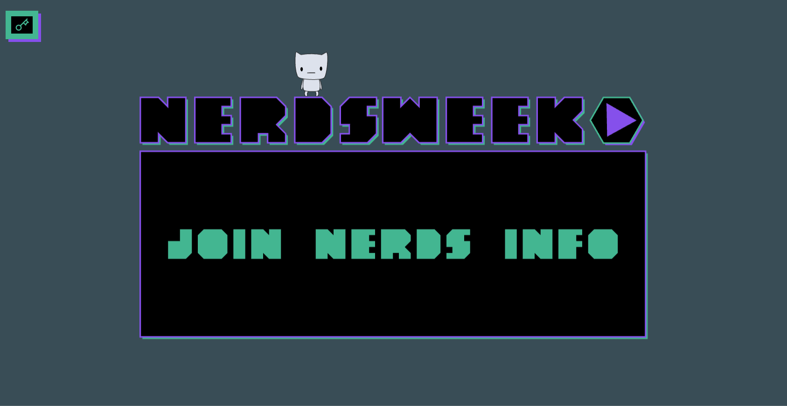
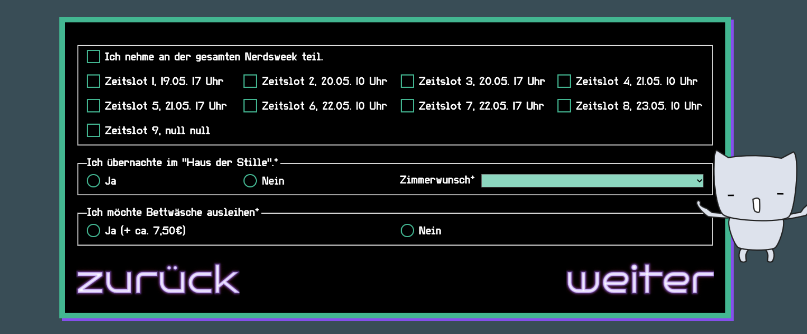
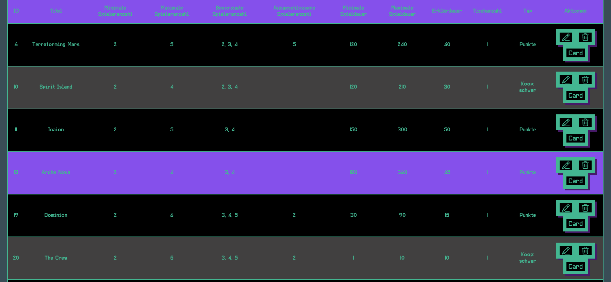
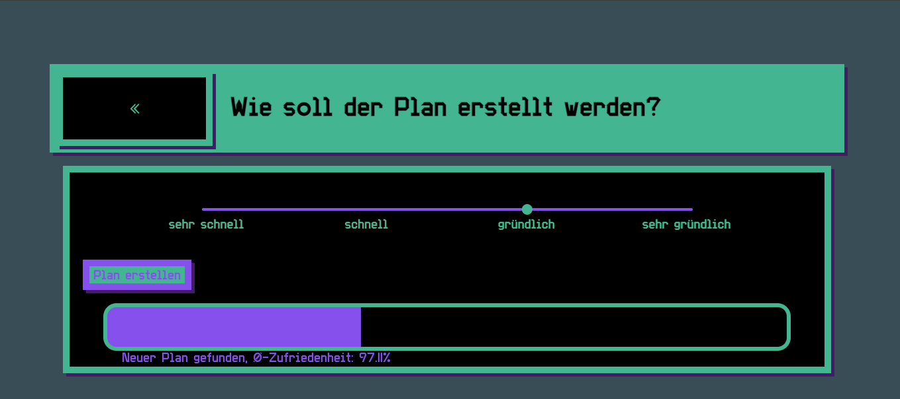
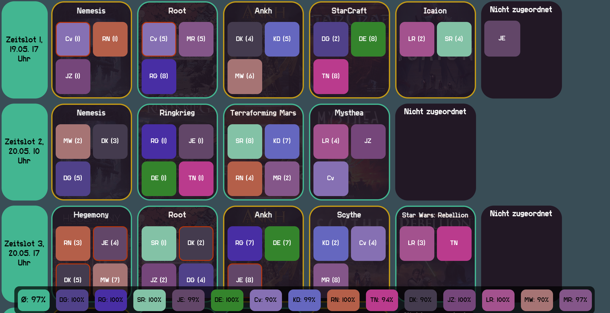

# Demonstration der Nerdsweek-Webapp

Die Nerdsweek ist ein jährlich ausgerichtetes mehrtägiges Brettspielevent, bei dem sich Brettspielfans treffen, um ihre Lieblingsspiele in parallel stattfindenden Partien zu spielen. Um die Reichweite zu erhöhen und den Anmeldeprozess auf das nächste Level zu bringen, entwickle ich die Webapp Nerdsweek. Die folgende Projektpräsentation gibt einen Einblick in das bisherige Design, die Benutzerführung und die interaktiven Funktionen der Webapp.

## User-Erlebnis

Präsentiert werden hier Ausschnitte aus dem für den User sichtbaren Teil der Website.

### Intro-Page
Auf der Intro-Seite wird der User von einer kleinen, in Rive erstellten Animationssequenz empfangen, die in einem kleinen Auswahlmenü endet. Von Anfang an wird er dabei von dem Nerdsweek-Maskottchen "Nerdy" begleitet. Das Intro ist bewusst kreativ und verspielt, trifft damit also genau den Kern, um den es beim Event geht.

### Join-Page
Der User kann sich über diese Seite zur nächsten Nerdsweek anmelden und wird dabei durch die einzelnen wichtigen Punkte geleitet. Nerdy ist auch hier dabei und lächelt (meistens). Bei der Gestaltung habe ich bewusst auf ein schlichtes und dennoch ansprechendes Design gesetzt.

### Interaktive Spieleauswahl

Am Ende der Join-Page findet sich die Spieleauswahl, bei der bis zu acht Spielefavoriten in einer individuellen Rangfolge ausgewählt werden können. Der Fokus liegt hier auf einer guten Übersicht aller verfügbaren Spiele. Die Cover regen auch dazu an, Spiele näher zu betrachten, die noch unbekannt sind. Nach erfolgter Spielauswahl ist gut nachzuvollziehen, welche Spiele ausgewählt wurden – eine nachträgliche Korrektur ist auch simpel möglich.

https://github.com/user-attachments/assets/f4c429ca-2b3e-4580-8326-3d0b3a15466b

## Admin-Zugang

Personen mit entsprechenden Zugangsdaten können sich in den Adminbereich einloggen (erreichbar über den kleinen Schlüssel in der oberen linken Ecke der Intro-Page).

### Verwaltung der Datenbank
Admins erhalten Einblick in die Anmeldungen und können diese nachträglich löschen, bearbeiten oder einen komplett neuen User anmelden. Zudem ist die Verwaltung der Spieledatenbank hierüber möglich.

### Das Planungsmodul
Über die Planungsseite erhalten Admins die Möglichkeit, einen Spielplan für die Veranstaltung zu erstellen. Die initiale Planerstellung erfolgt bislang ausschließlich automatisiert. Es kann gewählt werden, wie gründlich der Algorithmus arbeiten soll. Nach einem Klick auf "Plan erstellen" wird über einen Fortschrittsbalken angezeigt, wie weit der Algorithmus ist.

Der erstellte Plan kann nachträglich via Drag and Drop bearbeitet werden. Die farbliche Zuordnung der Teilnehmenden ermöglicht es, deren Verteilung über die verschiedenen Zeitslots hinweg schnell zu erfassen. Farbige Umrandungen der Spielerkacheln bei Unstimmigkeiten und die kontinuierlich aktualisierte Zufriedenheitsübersicht geben dem Admin bei der Bearbeitung unmittelbares visuelles Feedback. Auch die Kacheln jeder Spielpartie sind farblich unterschiedlich umrandet, je nachdem, ob die Spielerzahl zum betreffenden Spiel passt (grün = bevorzugt, gelb = in Ordnung/keine präferierte Spielerzahl angegeben, rot = Spielerzahl für das Spiel ungeeignet).

https://github.com/user-attachments/assets/ad236afc-05a7-4eed-b3d7-1d1f01a86cd1

## Responsive Gestaltung
Über die ganze Website hinweg habe ich auf eine responsive Gestaltung geachtet, damit die Webapp auf den unterschiedlichsten Bildschirmgrößen funktioniert. Als Beispiel wird hier nochmal die Planübersicht gezeigt. Auf dem zweiten Bild wurden zudem mittels des Schiebereglers die Kacheln verkleinert, um auch auf einem kleineren Bildschirm auf einen Blick mehr sehen zu können.

.png>)

